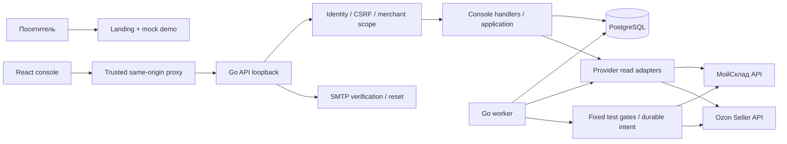

# Архитектура STYK

## Реальный стиль

CONFIRMED: модульный Go-монолит, раздельные исполняемые процессы api и worker. Данные и durable queues общие в PostgreSQL. React SPA отдельно. Это не .NET solution и не набор микросервисов. Источники: go.mod; cmd/api/main.go; cmd/worker/main.go; internal/application/worker.go.

WB/Yandex отсутствуют в исполнительной части. Стрелки через Gates обозначают ограниченные тестовые записи, не production-возможность для всех tenant.

## Слои и границы

1. Domain: internal/domain, catalog, commitment, matching, ordercorrelation. Meaningful identities, exact scope, evidence/unknown states; pure plan/calculation.
2. Application: orchestration импортов, mappings, customer-order/posting reads, worker lifecycle. Small consumer-side interfaces.
3. Persistence: postgres.Store with pgxpool. SQL, locks, idempotency records, commit/rollback, actor checks.
4. Infrastructure: typed HTTP clients, response budgets, rate limiting, retry/readback. Writer capabilities выделены из readers.
5. Transport: console реализует business API; transport только health. Исходное AGENTS описание «transport only health» не означает отсутствия business endpoints.
6. UI: TanStack Query + local React state; API wrappers/CSRF; explicit review/confirm/reconcile flows.

Чистота границ частичная: console/http.go и order_evidence.go сами выполняют SQL/coordination; postgres.Store охватывает много доменов. Это maintainability debt, не само по себе дефект исполнения.

## Три разных durable механизма

- Mock inventory: inventory_observations → outbox_tasks → MockHandler → result. Не внешняя синхронизация.
- Read imports: HTTP creates scoped operation + outbox, worker читает provider вне транзакции, commits observations и fenced result вместе. Безопасность повторного чтения не переносится на writes.
- External mutations: frozen preview/approval/intent, per-target state, claim fencing, guards, dispatch journal, receipt, readback, UNKNOWN и reconciliation. Catalog и stock имеют собственные таблицы и правила.

## Контекст и транзакции

HTTP отмена/timeout распространяется в I/O. SQL операции ограничены query timeout. Каталожный Runner.complete использует bounded context.WithoutCancel, чтобы сохранить outcome после отмены внешнего вызова. Нельзя держать SQL transaction на время provider I/O. Outbox claims используют SKIP LOCKED, claim tokens и lease; отдельные scopes сериализуются advisory locks.

No exactly-once claim: transport timeout не доказывает отказ provider. UNKNOWN удерживает fence; слепой resend запрещён дизайном. Ослаблять это ради «попробовать ещё» нельзя.

## Security authority

Текущий tenant определяется MerchantTenant по user → saas_merchant_accounts, а не полем браузера. Scope middleware проверяет/replaces tenant в query/body; review object привязан к session audit. DB actor guard повторно проверяет actor после получения row locks (migration 42).

Это не DB sandbox: отсутствие RLS и доверенные CLI/worker означают, что прямой DB доступ — административная возможность. Browser account selection не заменяет ownership check.

## Технологические решения и неизвестное

PostgreSQL одновременно operational store, audit/evidence store и queue. Redis/RabbitMQ/Kafka/object storage как runtime-зависимости STYK не найдены. Нет доказательства, что они нужны до измерений; сначала load tests, backlog age и DB contention. Нет подтверждённого production proxy, multi-host deployment, backup policy или инфраструктуры алертов.

Ссылки на подробности: 04, 06, 07, 08, 09, 14.

## Source evidence index

Static inspection only. Line numbers refer to this working tree, not a release tag. External sibling paths are intentionally absolute; source is not included in the ZIP.

| Source | Symbols / evidence lines |
|---|---|
| [cmd/api/main.go:1](../../cmd/api/main.go#L1) | 21: main; 27: run; 66: configuredHandler; 90: apiForMode |
| [cmd/worker/main.go:1](../../cmd/worker/main.go#L1) | 28: catalogClient; 85: moyskladCatalogClient; 142: main; 148: run |
| [internal/application/worker.go:1](../../internal/application/worker.go#L1) | 38: Process; 62: Run; 150: advanceCatalog |
| [internal/postgres/store.go:1](../../internal/postgres/store.go#L1) | 22: Open; 35: Ping; 42: Submit; 73: Claim; 79: ClaimForWorker; 82: ClaimForCatalogWorker; 85: ClaimForCredentialWorker; 88: claim; 125: Finish; 162: rollbackTransaction; 171: ExpireExhausted; 191: RenewImportClaim |
| [internal/catalogsync/contracts.go:1](../../internal/catalogsync/contracts.go#L1) | 315: ResolveCatalog |
| [internal/console/merchant_scope.go:1](../../internal/console/merchant_scope.go#L1) | 18: authorizeScope; 47: scopeRequest; 72: isMappingReviewObject; 76: reviewWorkspace; 93: scopeMerchantBody; 125: merchantObject |
| [migrations/00042_merchant_actor_expiry_fence.sql:1](../../migrations/00042_merchant_actor_expiry_fence.sql#L1) | configuration / declarations; see file |

## Internal package dependency inventory

Imports found in production Go files. This shows code dependencies, not runtime network calls. Standard-library and external-module imports are omitted here.

| Consumer package | Internal package imports |
|---|---|
| `internal/application` | `domain` |
| `internal/catalog` | no internal imports found |
| `internal/catalogprovider` | `catalog`, `catalogsync`, `credentials`, `infrastructure/moysklad`, `infrastructure/ozon` |
| `internal/catalogsync` | `catalog` |
| `internal/commitment` | `domain` |
| `internal/config` | no internal imports found |
| `internal/console` | `application`, `catalog`, `catalogprovider`, `catalogsync`, `config`, `credentials`, `doctor`, `domain`, `identity`, `infrastructure/moysklad`, `infrastructure/ozon`, `matching`, `postgres`, `stocksync`, `testpublication` |
| `internal/credentials` | no internal imports found |
| `internal/doctor` | no internal imports found |
| `internal/doctordemo` | `domain`, `postgres` |
| `internal/domain` | no internal imports found |
| `internal/identity` | no internal imports found |
| `internal/infrastructure` | `application`, `catalog`, `domain`, `testpublication` |
| `internal/matching` | `domain` |
| `internal/moyskladfixture` | no internal imports found |
| `internal/ordercorrelation` | `domain` |
| `internal/ozonjob` | `application`, `credentials`, `domain`, `infrastructure/moysklad`, `infrastructure/ozon`, `postgres` |
| `internal/postgres` | `application`, `catalog`, `catalogsync`, `commitment`, `config`, `credentials`, `doctor`, `domain`, `identity`, `matching`, `ordercorrelation`, `testpublication` |
| `internal/stocksync` | `config`, `domain`, `infrastructure/ozon`, `postgres`, `testpublication` |
| `internal/testpublication` | `domain` |
| `internal/transport` | no internal imports found |
