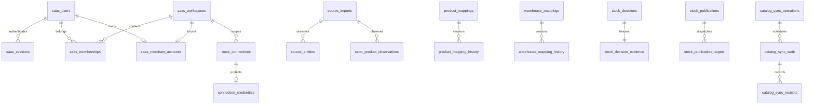

# База данных и целостность

## Модель

PostgreSQL; Compose/CI указывают image postgres:17.6. Go использует pgxpool, не DbContext/ORM. Миграции Goose 00001–00044, последовательно Up/Down в SQL. 44 файла миграций не означают 44 таблицы. Ни schema, ни records живой БД в этом аудите не запрашивались: далее описание схемы из SQL.

Основные кластеры: identity/merchant; external ownership/credentials; source imports/observations; mappings/reviews/audits; stock policy/evidence/publications/recovery; automatic cycles; order evidence/progress; catalog configs/operations/work/receipts/baselines/readbacks; outbox.

## ER-описание

Диаграмма — логические основные связи, не обещание, что каждая стрелка выражена одним literal FK. Для exact constraints использовать SQL inventory ниже; source_imports связывает provider-specific observation lineage через source/account/batch, а не единый универсальный entity ORM.

## Tenant isolation

Слои:
1. MerchantTenant получает sole tenant из user binding; legacy membership сама по себе доступа не даёт.
2. HTTP middleware отвергает чужой tenant, injects own scope; reviews дополнительно связаны session audit ID.
3. SQL содержит tenant + provider account predicates; ownership registry stock_connections.
4. Composite foreign keys/checks/unique guards предотвращают cross-scope associations.
5. Mutations с merchant actor повторно проверяют session/user/binding/membership в той же транзакции. Migration 42 сначала получает SHARE locks, затем заново проверяет expiry через clock_timestamp.

Важный предел: migrations не вводят PostgreSQL ROW LEVEL SECURITY. requireContextActor разрешает путь без identity context для trusted CLI/worker; это не механизм защиты от произвольного DB user. Нельзя предоставить клиентам прямой DB доступ или назвать composite FK полноценной row-level authorization.

Migration 39 устанавливает UNIQUE tenant binding и OWNER-only resolution. Multi-user team модель из membership enum не является доступной коммерческой функцией.

## Хранение данных и immutable history

Source observations сохраняют историю локальных traversal, timestamps и lineage. Missing stock/nullable quantities остаются unknown. Маппинги имеют current/version/history; reviews фиксируют revisions и expected evidence. Stock decisions/evidence и security events защищены от изменения triggers/constraints. Audit != произвольный application log.

Soft delete не универсален: users имеют disabled_at, memberships/sessions revoked_at, credentials enabled, source archived сохраняется как факт. Удаление privacy data потребует специальной политики, совместимой с immutable audit.

Idempotency: operation_key mock tasks; credential request records; mapping confirmation idempotency; stock mutation/request hashes; catalog approvals/config revisions/commands/dispatch intents. Повтор запроса с иным содержимым должен conflict, а не silently overwrite.

## Transactions и concurrency

postgres.Store owns Begin/Commit/Rollback. Import делает provider reads до transaction; transaction объединяет observations и fenced task result. SKIP LOCKED обеспечивает конкурентный claim, claim_token предотвращает stale finish. Scope advisory locks сериализуют account/mapping/target operations; composite uniqueness ограничивает duplicate identity.

Catalog DISPATCHING при истечении lease становится UNKNOWN; takeover не означает разрешение повторного внешнего write. Unknown target fences и readback claims сохраняются отдельно. Stock recovery имеет собственные worker presence/links/fences.

У ряда Down migrations есть отказ при наличии business/audit data. Это правильная защита от потери истории и одновременно эксплуатационное ограничение: rollback релиза не равен goose down. Нужны compatibility план и restore rehearsal.

## Индексы и производительность

Есть scoped indexes для последнего import, name search/stock lists, decisions/history, pending queues и active memberships/sessions. Migration 16 добавляет console stock indexes; 41 — names; catalog queries используют keyset/cursor/revision. Наличие индекса не подтверждает достаточность для миллионов rows: EXPLAIN/ANALYZE не запускался, статистика/размеры/partitioning неизвестны.

Append-only observations и JSONB catalog snapshots/receipts увеличивают storage и WAL. Нет подтверждённого retention/partitioning/vacuum capacity плана. Long history/review JSON может стать bottleneck даже при bounded UI page.

## Что запрещено было проверять

Не запускались migrate/down, seed, DB integration fixtures, EXPLAIN ANALYZE или cleanup. Для проверки нужны dedicated disposable test database, transaction/concurrency tests, restore test и безопасные production-shaped datasets. Дампы и реальные записи не входят в отчёт.

## Автоматический migration inventory

Ниже добавлены точные имена CREATE TABLE, индексов и FK-ссылок по каждому Up-блоку. Это декларации из файлов, не доказательство установленной версии работающей БД.

## Source evidence index

Static inspection only. Line numbers refer to this working tree, not a release tag. External sibling paths are intentionally absolute; source is not included in the ZIP.

| Source | Symbols / evidence lines |
|---|---|
| [migrations/00014_stock_commitment.sql:1](../../migrations/00014_stock_commitment.sql#L1) | 3: stock_connections; 14: stock_pools; 27: stock_policies; 46: stock_decisions; 88: stock_decision_evidence |
| [migrations/00023_connection_credentials.sql:1](../../migrations/00023_connection_credentials.sql#L1) | 4: connection_credentials; 19: credential_save_requests |
| [migrations/00033_saas_identity.sql:1](../../migrations/00033_saas_identity.sql#L1) | 2: saas_users; 12: saas_workspaces; 31: saas_memberships; 41: saas_sessions; 54: saas_password_resets; 64: saas_email_verifications; 74: saas_security_events; 86: saas_auth_limits |
| [migrations/00035_tenant_reference_guards.sql:1](../../migrations/00035_tenant_reference_guards.sql#L1) | configuration / declarations; see file |
| [migrations/00039_merchant_accounts.sql:1](../../migrations/00039_merchant_accounts.sql#L1) | 6: saas_merchant_accounts |
| [migrations/00042_merchant_actor_expiry_fence.sql:1](../../migrations/00042_merchant_actor_expiry_fence.sql#L1) | configuration / declarations; see file |
| [migrations/00043_catalog_sync.sql:1](../../migrations/00043_catalog_sync.sql#L1) | 4: catalog_sync_configs; 18: catalog_sync_config_revisions; 36: catalog_sync_associations; 73: catalog_sync_enrollments; 84: catalog_sync_snapshots; 98: catalog_sync_previews; 113: catalog_sync_preview_snapshots; 127: catalog_sync_approvals; 142: catalog_sync_operations; 155: catalog_sync_work; 184: catalog_sync_commands; 193: catalog_sync_attempts |
| [migrations/00044_catalog_readback_review.sql:1](../../migrations/00044_catalog_readback_review.sql#L1) | 2: catalog_sync_readbacks; 23: catalog_sync_readback_claims; 30: catalog_sync_readback_results |
| [internal/postgres/store.go:1](../../internal/postgres/store.go#L1) | 22: Open; 35: Ping; 42: Submit; 73: Claim; 79: ClaimForWorker; 82: ClaimForCatalogWorker; 85: ClaimForCredentialWorker; 88: claim; 125: Finish; 162: rollbackTransaction; 171: ExpireExhausted; 191: RenewImportClaim |
| [internal/postgres/merchant_actor.go:1](../../internal/postgres/merchant_actor.go#L1) | 15: auditPrincipal; 22: rollbackMerchantMutation; 30: requireContextActor; 38: ensureConnectionWorkspace; 49: requireMerchantActor |

| Migration | Tables declared in Up | Index names declared in Up | FK referenced tables |
|---|---|---|---|
| [00001_initial.sql](../../migrations/00001_initial.sql) | `inventory_observations`, `outbox_tasks` | `outbox_claim_idx` | `inventory_observations` |
| [00002_moysklad_read.sql](../../migrations/00002_moysklad_read.sql) | `source_imports`, `source_entities`, `source_stock_observations` | `source_imports_latest_idx` | `source_imports` |
| [00003_warehouse_stock.sql](../../migrations/00003_warehouse_stock.sql) | `source_warehouse_stock_observations` | - | `source_imports` |
| [00004_ozon_observations.sql](../../migrations/00004_ozon_observations.sql) | `ozon_import_batches`, `ozon_product_observations`, `ozon_warehouse_observations`, `ozon_fbs_stock_observations` | - | `ozon_import_batches`, `ozon_product_observations`, `source_imports` |
| [00005_product_mapping.sql](../../migrations/00005_product_mapping.sql) | `product_mappings`, `product_mapping_history` | `product_mappings_target_idx` | `product_mappings`, `source_imports` |
| [00006_warehouse_mapping.sql](../../migrations/00006_warehouse_mapping.sql) | `warehouse_mappings`, `warehouse_mapping_history` | - | `source_imports`, `warehouse_mappings` |
| [00007_ozon_postings.sql](../../migrations/00007_ozon_postings.sql) | `ozon_posting_batches`, `ozon_posting_observations`, `ozon_posting_lines` | `ozon_posting_batches_scope_idx` | `ozon_posting_batches`, `ozon_posting_observations` |
| [00008_ozon_posting_observation_details.sql](../../migrations/00008_ozon_posting_observation_details.sql) | ALTER/function/trigger only | `ozon_posting_identity_idx` | - |
| [00009_posting_constraints.sql](../../migrations/00009_posting_constraints.sql) | ALTER/function/trigger only | - | - |
| [00010_posting_time_basis.sql](../../migrations/00010_posting_time_basis.sql) | ALTER/function/trigger only | - | - |
| [00011_posting_additional_fields.sql](../../migrations/00011_posting_additional_fields.sql) | ALTER/function/trigger only | - | - |
| [00012_posting_identities.sql](../../migrations/00012_posting_identities.sql) | `ozon_posting_identities` | - | - |
| [00013_posting_scope_constraints.sql](../../migrations/00013_posting_scope_constraints.sql) | ALTER/function/trigger only | - | `ozon_posting_batches`, `ozon_posting_identities` |
| [00014_stock_commitment.sql](../../migrations/00014_stock_commitment.sql) | `stock_connections`, `stock_pools`, `stock_policies`, `stock_decisions`, `stock_decision_evidence` | `stock_shared_product_idx`, `stock_shared_source_warehouse_idx`, `stock_shared_ozon_warehouse_idx`, `stock_decisions_pool_idx` | `ozon_fbs_stock_observations`, `ozon_posting_batches`, `product_mapping_history`, `source_imports`, `source_warehouse_stock_observations`, `stock_connections`, `stock_decisions`, `stock_policies`, `stock_pools`, `warehouse_mapping_history` |
| [00015_customer_order_evidence.sql](../../migrations/00015_customer_order_evidence.sql) | `moy_order_batches`, `moy_order_identities`, `moy_order_observations`, `moy_order_positions` | `moy_order_batches_scope_idx`, `moy_order_identity_case_idx`, `moy_order_history_idx`, `moy_order_position_case_idx`, `moy_order_positions_item_idx` | `moy_order_batches`, `moy_order_identities`, `moy_order_observations`, `stock_connections` |
| [00016_console_stock_indexes.sql](../../migrations/00016_console_stock_indexes.sql) | ALTER/function/trigger only | `source_warehouse_stock_console_idx`, `ozon_fbs_stock_console_idx` | - |
| [00017_product_mapping_reviews.sql](../../migrations/00017_product_mapping_reviews.sql) | `product_mapping_reviews` | `product_mapping_reviews_session_idx` | `ozon_product_observations`, `source_entities`, `source_imports`, `stock_connections` |
| [00018_product_mapping_confirmation.sql](../../migrations/00018_product_mapping_confirmation.sql) | `product_mapping_confirmation_audits`, `product_mapping_confirmation_idempotency` | - | `product_mapping_confirmation_audits`, `product_mapping_history`, `product_mapping_reviews` |
| [00019_warehouse_mapping_reviews.sql](../../migrations/00019_warehouse_mapping_reviews.sql) | `warehouse_mapping_reviews` | `warehouse_mapping_reviews_session_idx` | `ozon_warehouse_observations`, `source_entities`, `source_imports`, `stock_connections`, `warehouse_mapping_history` |
| [00020_warehouse_mapping_confirmation.sql](../../migrations/00020_warehouse_mapping_confirmation.sql) | `warehouse_mapping_confirmation_audits`, `warehouse_mapping_confirmation_idempotency` | - | `warehouse_mapping_confirmation_audits`, `warehouse_mapping_history`, `warehouse_mapping_reviews` |
| [00021_ozon_import_operations.sql](../../migrations/00021_ozon_import_operations.sql) | `ozon_import_operations` | `ozon_import_operations_history_idx`, `outbox_import_operation_unique`, `outbox_one_active_ozon_catalog`, `outbox_ozon_account_claim_idx` | `ozon_import_batches`, `ozon_import_operations`, `source_imports`, `stock_connections` |
| [00022_moysklad_import_operations.sql](../../migrations/00022_moysklad_import_operations.sql) | ALTER/function/trigger only | `outbox_one_active_catalog`, `outbox_moysklad_account_claim_idx` | `ozon_import_operations` |
| [00023_connection_credentials.sql](../../migrations/00023_connection_credentials.sql) | `connection_credentials`, `credential_save_requests` | `credential_recent_provider` | `connection_credentials`, `stock_connections` |
| [00024_stock_publication.sql](../../migrations/00024_stock_publication.sql) | `stock_sync_reviews`, `stock_sync_settings`, `stock_publications`, `stock_publication_targets`, `stock_sync_mutations`, `stock_publication_dispatch_clock` | `stock_sync_reviews_scope_idx`, `stock_publications_scope_idx`, `stock_publication_target_fence`, `stock_publication_queue_idx`, `stock_publication_target_dispatch_idx` | `stock_connections`, `stock_publications`, `stock_sync_reviews`, `stock_sync_settings` |
| [00025_controlled_publication_outbox.sql](../../migrations/00025_controlled_publication_outbox.sql) | `stock_publication_readbacks` | `outbox_publication_operation_unique`, `stock_publication_target_fence` | `stock_publication_targets`, `stock_publications` |
| [00026_test_stock_supersession.sql](../../migrations/00026_test_stock_supersession.sql) | `stock_test_worker_presence`, `stock_publication_recoveries`, `stock_publication_recovery_links`, `stock_publication_target_fences` | - | `stock_publication_readbacks`, `stock_publication_recoveries`, `stock_publication_targets`, `stock_publications` |
| [00027_automatic_stock_sync.sql](../../migrations/00027_automatic_stock_sync.sql) | `stock_auto_configs`, `stock_auto_config_audits`, `stock_auto_cycles` | `stock_auto_one_active_cycle`, `stock_auto_due_cycle` | `ozon_import_operations`, `stock_auto_config_audits`, `stock_auto_configs`, `stock_publications`, `stock_sync_settings` |
| [00028_stock_provider_results.sql](../../migrations/00028_stock_provider_results.sql) | ALTER/function/trigger only | - | - |
| [00029_automatic_cycle_targets.sql](../../migrations/00029_automatic_cycle_targets.sql) | `stock_auto_cycle_publications` | - | `stock_auto_cycles`, `stock_publications` |
| [00030_enrolled_test_recovery.sql](../../migrations/00030_enrolled_test_recovery.sql) | ALTER/function/trigger only | - | - |
| [00031_initial_stock_publications.sql](../../migrations/00031_initial_stock_publications.sql) | `stock_initial_publications` | - | `stock_auto_config_audits`, `stock_publications` |
| [00032_initial_takeover_renewal.sql](../../migrations/00032_initial_takeover_renewal.sql) | ALTER/function/trigger only | - | - |
| [00033_saas_identity.sql](../../migrations/00033_saas_identity.sql) | `saas_users`, `saas_workspaces`, `saas_memberships`, `saas_sessions`, `saas_password_resets`, `saas_email_verifications`, `saas_security_events`, `saas_auth_limits` | `saas_memberships_user`, `saas_sessions_user`, `saas_password_resets_user`, `saas_email_verifications_user`, `saas_security_events_scope` | `saas_users`, `saas_workspaces` |
| [00034_merchant_audit_principal.sql](../../migrations/00034_merchant_audit_principal.sql) | ALTER/function/trigger only | - | - |
| [00035_tenant_reference_guards.sql](../../migrations/00035_tenant_reference_guards.sql) | ALTER/function/trigger only | - | `saas_workspaces`, `stock_connections` |
| [00036_merchant_posting_guard.sql](../../migrations/00036_merchant_posting_guard.sql) | ALTER/function/trigger only | - | - |
| [00037_read_only_sync_drafts.sql](../../migrations/00037_read_only_sync_drafts.sql) | ALTER/function/trigger only | - | - |
| [00038_scoped_publication_links.sql](../../migrations/00038_scoped_publication_links.sql) | ALTER/function/trigger only | - | `ozon_import_operations`, `stock_publications`, `stock_sync_reviews` |
| [00039_merchant_accounts.sql](../../migrations/00039_merchant_accounts.sql) | `saas_merchant_accounts` | - | `saas_memberships`, `saas_users`, `saas_workspaces` |
| [00040_order_evidence_progress.sql](../../migrations/00040_order_evidence_progress.sql) | `order_evidence_progress` | - | `moy_order_batches`, `ozon_posting_batches`, `stock_connections` |
| [00041_ozon_product_names.sql](../../migrations/00041_ozon_product_names.sql) | ALTER/function/trigger only | - | - |
| [00042_merchant_actor_expiry_fence.sql](../../migrations/00042_merchant_actor_expiry_fence.sql) | ALTER/function/trigger only | - | - |
| [00043_catalog_sync.sql](../../migrations/00043_catalog_sync.sql) | `catalog_sync_configs`, `catalog_sync_config_revisions`, `catalog_sync_associations`, `catalog_sync_enrollments`, `catalog_sync_snapshots`, `catalog_sync_previews`, `catalog_sync_preview_snapshots`, `catalog_sync_approvals`, `catalog_sync_operations`, `catalog_sync_work`, `catalog_sync_commands`, `catalog_sync_attempts`, `catalog_sync_receipts`, `catalog_sync_baselines`, `catalog_sync_rebases`, `catalog_sync_dispatch_intents` | `catalog_sync_due`, `catalog_sync_create_identity`, `catalog_sync_snapshot_identity`, `catalog_sync_preview_history`, `catalog_sync_operation_history`, `catalog_sync_active_target`, `catalog_sync_work_operation`, `catalog_sync_one_dispatch`, `catalog_sync_latest_baseline`, `catalog_sync_outbox_operation`, `catalog_sync_claim` | `catalog_sync_approvals`, `catalog_sync_associations`, `catalog_sync_config_revisions`, `catalog_sync_configs`, `catalog_sync_enrollments`, `catalog_sync_operations`, `catalog_sync_previews`, `catalog_sync_snapshots`, `catalog_sync_work`, `product_mapping_history`, `stock_connections` |
| [00044_catalog_readback_review.sql](../../migrations/00044_catalog_readback_review.sql) | `catalog_sync_readbacks`, `catalog_sync_readback_claims`, `catalog_sync_readback_results` | `catalog_sync_readback_history` | `catalog_sync_readbacks`, `catalog_sync_work` |

Total CREATE TABLE declarations in Up blocks: 81. This is not a live database table count.

## Table field and constraint inventory

Initial CREATE declarations only. Later ALTER migrations above must be applied to reconstruct the final schema; this inventory is not an ORM model or live database export.

| Table | Declared column identifiers | PK / UNIQUE / CHECK / FK clauses | Source |
|---|---|---|---|
| `inventory_observations` | `id`, `operation_key`, `source`, `sku`, `quantity`, `observed_at` | 1 / 1 / 1 / 0 | `00001_initial.sql` |
| `outbox_tasks` | `id`, `operation_key`, `observation_id`, `state`, `attempts`, `max_attempts`, `available_at`, `lease_until`, `claim_token`, `result`, `last_error`, `created_at`, `updated_at` | 1 / 1 / 2 / 1 | `00001_initial.sql` |
| `source_imports` | `id`, `source`, `account_id`, `fingerprint`, `started_at`, `finished_at`, `report_scope` | 1 / 0 / 0 / 0 | `00002_moysklad_read.sql` |
| `source_entities` | `import_id`, `kind`, `external_id`, `name`, `code`, `article`, `parent_id`, `source_updated` | 1 / 0 / 0 / 1 | `00002_moysklad_read.sql` |
| `source_stock_observations` | `import_id`, `kind`, `external_id`, `source_href`, `stock`, `reserve`, `in_transit`, `quantity`, `free_stock` | 1 / 0 / 0 / 1 | `00002_moysklad_read.sql` |
| `source_warehouse_stock_observations` | `import_id`, `kind`, `external_id`, `source_href`, `warehouse_id`, `warehouse_href`, `stock`, `reserve`, `in_transit`, `quantity`, `observed_at` | 1 / 0 / 1 / 1 | `00003_warehouse_stock.sql` |
| `ozon_import_batches` | `import_id`, `traversal_status` | 1 / 0 / 1 / 1 | `00004_ozon_observations.sql` |
| `ozon_product_observations` | `import_id`, `product_id`, `offer_id`, `sku`, `archived` | 1 / 1 / 0 / 1 | `00004_ozon_observations.sql` |
| `ozon_warehouse_observations` | `import_id`, `warehouse_id`, `name`, `status`, `warehouse_type`, `is_rfbs` | 1 / 0 / 0 / 1 | `00004_ozon_observations.sql` |
| `ozon_fbs_stock_observations` | `import_id`, `product_id`, `offer_id`, `sku`, `warehouse_id`, `warehouse_name`, `present`, `reserved`, `free_stock`, `observed_at` | 1 / 0 / 0 / 2 | `00004_ozon_observations.sql` |
| `product_mappings` | `id`, `tenant_id`, `ozon_account`, `ozon_product_id`, `ozon_offer_id`, `moysklad_account`, `target_kind`, `target_id`, `version`, `provenance`, `confirmed_at` | 1 / 2 / 9 / 0 | `00005_product_mapping.sql` |
| `product_mapping_history` | `mapping_id`, `version`, `tenant_id`, `ozon_account`, `ozon_product_id`, `ozon_offer_id`, `moysklad_account`, `target_kind`, `target_id`, `provenance`, `confirmed_at`, `ozon_import_id`, `moysklad_import_id` | 1 / 0 / 3 / 3 | `00005_product_mapping.sql` |
| `warehouse_mappings` | `id`, `tenant_id`, `moysklad_account`, `ozon_account`, `moysklad_warehouse_id`, `ozon_warehouse_id`, `status`, `version`, `provenance`, `confirmed_at` | 1 / 2 / 8 / 0 | `00006_warehouse_mapping.sql` |
| `warehouse_mapping_history` | `mapping_id`, `version`, `tenant_id`, `moysklad_account`, `ozon_account`, `moysklad_warehouse_id`, `ozon_warehouse_id`, `status`, `provenance`, `confirmed_at`, `moysklad_import_id`, `ozon_import_id` | 1 / 0 / 0 / 3 | `00006_warehouse_mapping.sql` |
| `ozon_posting_batches` | `id` | 1 / 0 / 1 / 0 | `00007_ozon_postings.sql` |
| `ozon_posting_observations` | `id` | 1 / 1 / 0 / 1 | `00007_ozon_postings.sql` |
| `ozon_posting_lines` | `observation_id` | 1 / 0 / 1 / 1 | `00007_ozon_postings.sql` |
| `ozon_posting_identities` | `tenant_id`, `account_id`, `posting_number`, `order_id` | 1 / 0 / 4 / 0 | `00012_posting_identities.sql` |
| `stock_connections` | `tenant_id`, `source`, `account_id`, `provenance`, `include_import_history`, `registered_at` | 1 / 1 / 4 / 0 | `00014_stock_commitment.sql` |
| `stock_pools` | `id`, `tenant_id`, `source`, `account_id`, `warehouse_id`, `item_kind`, `item_id` | 1 / 2 / 4 / 1 | `00014_stock_commitment.sql` |
| `stock_policies` | `tenant_id`, `version`, `unit`, `safety_stock`, `max_observation_age_ns`, `decision_lifetime_ns` | 1 / 0 / 4 / 0 | `00014_stock_commitment.sql` |
| `stock_decisions` | `id`, `tenant_id`, `pool_id`, `moysklad_account`, `moysklad_warehouse_id`, `item_kind`, `item_id`, `ozon_source`, `ozon_account`, `ozon_warehouse_id`, `ozon_product_id`, `offer_id`, `product_mapping_id`, `product_mapping_version`, `warehouse_mapping_id`, `warehouse_mapping_version`, `policy_version`, `evaluated_at`, `expires_at`, `status`, `quantity`, `decision` | 1 / 1 / 9 / 5 | `00014_stock_commitment.sql` |
| `stock_decision_evidence` | `decision_id`, `tenant_id`, `pool_id`, `moysklad_source`, `moysklad_account`, `moysklad_warehouse_id`, `item_kind`, `item_id`, `ozon_source`, `ozon_account`, `ozon_warehouse_id`, `ozon_product_id`, `moysklad_import_id`, `moysklad_stock_import_id`, `ozon_import_id`, `ozon_stock_import_id`, `posting_batch_id`, `snapshot` | 1 / 0 / 5 / 7 | `00014_stock_commitment.sql` |
| `moy_order_batches` | `id`, `tenant_id`, `source`, `account_id`, `window_from`, `window_to`, `started_at`, `finished_at`, `traversal_status` | 1 / 1 / 4 / 1 | `00015_customer_order_evidence.sql` |
| `moy_order_identities` | `tenant_id`, `source`, `account_id`, `order_id` | 1 / 0 / 2 / 1 | `00015_customer_order_evidence.sql` |
| `moy_order_observations` | `id`, `batch_id`, `tenant_id`, `account_id`, `order_id`, `sync_id`, `state_id`, `warehouse_id`, `source_created`, `source_updated`, `source_deleted`, `source_moment`, `applicable`, `observed_at` | 1 / 2 / 0 / 2 | `00015_customer_order_evidence.sql` |
| `moy_order_positions` | `observation_id`, `tenant_id`, `account_id`, `position_id`, `assortment_kind`, `assortment_id`, `quantity`, `reserve`, `shipped`, `pack_id`, `pack_unit_id`, `pack_quantity`, `observed_at` | 1 / 0 / 2 / 1 | `00015_customer_order_evidence.sql` |
| `product_mapping_reviews` | `id`, `tenant_id`, `ozon_source`, `ozon_account`, `moysklad_source`, `moysklad_account`, `ozon_product_id`, `target_kind`, `target_id`, `ozon_import_id`, `moysklad_import_id`, `existing_mapping_id`, `existing_mapping_version`, `observation_hash`, `mapping_hash`, `evidence_class`, `principal_type`, `session_audit_id`, `created_at`, `expires_at` | 1 / 0 / 14 / 6 | `00017_product_mapping_reviews.sql` |
| `product_mapping_confirmation_audits` | `mapping_id`, `mapping_version`, `review_id`, `tenant_id`, `ozon_account`, `moysklad_account`, `ozon_product_id`, `ozon_offer_id`, `target_kind`, `target_id`, `ozon_import_id`, `moysklad_import_id`, `evidence_class`, `principal_type`, `session_audit_id`, `explanation`, `confirmed_at` | 1 / 2 / 5 / 3 | `00018_product_mapping_confirmation.sql` |
| `product_mapping_confirmation_idempotency` | `review_id`, `session_audit_id`, `idempotency_key`, `request_hash`, `mapping_id`, `mapping_version` | 1 / 0 / 2 / 1 | `00018_product_mapping_confirmation.sql` |
| `warehouse_mapping_reviews` | `id`, `tenant_id`, `ozon_source`, `ozon_account`, `moysklad_source`, `moysklad_account`, `moysklad_kind`, `moysklad_warehouse_id`, `ozon_warehouse_id`, `moysklad_import_id`, `ozon_import_id`, `moysklad_import_fingerprint`, `ozon_import_fingerprint`, `observation_hash`, `mapping_hash`, `existing_mapping_id`, `existing_mapping_version`, `principal_type`, `session_audit_id`, `created_at`, `expires_at` | 1 / 0 / 13 / 7 | `00019_warehouse_mapping_reviews.sql` |
| `warehouse_mapping_confirmation_audits` | `mapping_id`, `mapping_version`, `review_id`, `tenant_id`, `ozon_account`, `moysklad_account`, `moysklad_warehouse_id`, `ozon_warehouse_id`, `ozon_import_id`, `moysklad_import_id`, `evidence_class`, `principal_type`, `session_audit_id`, `explanation`, `confirmed_at` | 1 / 2 / 4 / 3 | `00020_warehouse_mapping_confirmation.sql` |
| `warehouse_mapping_confirmation_idempotency` | `review_id`, `session_audit_id`, `idempotency_key`, `request_hash`, `mapping_id`, `mapping_version` | 1 / 0 / 2 / 1 | `00020_warehouse_mapping_confirmation.sql` |
| `ozon_import_operations` | `id`, `tenant_id`, `provider`, `account_id`, `operation_type`, `idempotency_key`, `request_fingerprint`, `principal_type`, `session_audit_id`, `limits`, `counters`, `phase`, `outcome`, `limiting_resource`, `created_at`, `started_at`, `attempt_started_at`, `progress_at`, `finished_at`, `batch_id`, `batch_created` | 1 / 2 / 14 / 3 | `00021_ozon_import_operations.sql` |
| `connection_credentials` | `tenant_id`, `provider`, `account_id`, `name`, `revision`, `enabled`, `ciphertext`, `updated_at`, `checked_at`, `last_request_id` | 1 / 0 / 5 / 1 | `00023_connection_credentials.sql` |
| `credential_save_requests` | `tenant_id`, `provider`, `request_id`, `request_digest`, `account_id`, `name`, `revision`, `enabled`, `checked_at`, `updated_at` | 1 / 0 / 4 / 1 | `00023_connection_credentials.sql` |
| `stock_sync_reviews` | `id`, `tenant_id`, `moysklad_account`, `ozon_account`, `ready`, `snapshot`, `created_at`, `expires_at` | 1 / 0 / 3 / 0 | `00024_stock_publication.sql` |
| `stock_sync_settings` | `tenant_id`, `moysklad_account`, `ozon_account`, `enabled`, `review_id`, `updated_at`, `last_evaluation_key`, `last_proof_check_at`, `last_checks`, `moysklad_source`, `ozon_source` | 1 / 0 / 2 / 3 | `00024_stock_publication.sql` |
| `stock_publications` | `id`, `tenant_id`, `moysklad_account`, `ozon_account`, `review_id`, `created_at` | 1 / 0 / 1 / 2 | `00024_stock_publication.sql` |
| `stock_publication_targets` | `id`, `operation_id`, `ozon_account`, `product_id`, `warehouse_id`, `quantity`, `state`, `safe_error`, `decision`, `dispatched_at`, `finished_at` | 1 / 1 / 3 / 1 | `00024_stock_publication.sql` |
| `stock_sync_mutations` | `tenant_id`, `moysklad_account`, `ozon_account`, `idempotency_key`, `request_hash`, `action`, `operation_id`, `created_at` | 1 / 0 / 1 / 1 | `00024_stock_publication.sql` |
| `stock_publication_dispatch_clock` | `ozon_account`, `dispatched_at` | 1 / 0 / 0 / 0 | `00024_stock_publication.sql` |
| `stock_publication_readbacks` | `id`, `target_id`, `observed_at`, `quantity`, `outcome` | 1 / 0 / 3 / 1 | `00025_controlled_publication_outbox.sql` |
| `stock_test_worker_presence` | `tenant_id`, `worker_id` | 1 / 0 / 0 / 0 | `00026_test_stock_supersession.sql` |
| `stock_publication_recoveries` | `id`, `target_id`, `tenant_id`, `product_id`, `readback_id`, `observed_quantity`, `observed_at`, `principal_type`, `session_audit_id`, `idempotency_key`, `request_hash`, `reason`, `accepted_uncertainty`, `worker_stopped_assertion`, `created_at` | 1 / 2 / 8 / 2 | `00026_test_stock_supersession.sql` |
| `stock_publication_recovery_links` | `recovery_id`, `new_operation_id`, `created_at` | 1 / 1 / 0 / 2 | `00026_test_stock_supersession.sql` |
| `stock_publication_target_fences` | `ozon_account`, `target_id` | 1 / 1 / 0 / 1 | `00026_test_stock_supersession.sql` |
| `stock_auto_configs` | `tenant_id`, `revision`, `next_run_at` | 1 / 0 / 2 / 1 | `00027_automatic_stock_sync.sql` |
| `stock_auto_config_audits` | `tenant_id`, `revision`, `principal_type`, `session_audit_id`, `idempotency_key`, `created_at` | 1 / 1 / 4 / 1 | `00027_automatic_stock_sync.sql` |
| `stock_auto_cycles` | `id`, `tenant_id`, `config_revision`, `state`, `outcome`, `next_action_at`, `moysklad_import_id`, `ozon_import_id`, `publication_id`, `reconcile_attempts`, `metrics` | 1 / 1 / 4 / 4 | `00027_automatic_stock_sync.sql` |
| `stock_auto_cycle_publications` | `cycle_id`, `publication_id`, `product_id`, `outcome` | 1 / 1 / 1 / 2 | `00029_automatic_cycle_targets.sql` |
| `stock_initial_publications` | `tenant_id`, `moysklad_account`, `ozon_account`, `product_id`, `warehouse_id`, `config_revision`, `publication_id`, `created_at` | 1 / 1 / 0 / 2 | `00031_initial_stock_publications.sql` |
| `saas_users` | `id`, `email`, `password_hash`, `auth_version`, `created_at`, `email_verified_at`, `disabled_at` | 1 / 1 / 4 / 0 | `00033_saas_identity.sql` |
| `saas_workspaces` | `id`, `name`, `legacy_unclaimed`, `created_at` | 1 / 0 / 2 / 0 | `00033_saas_identity.sql` |
| `saas_memberships` | `workspace_id`, `user_id`, `role`, `created_at`, `revoked_at` | 1 / 0 / 1 / 2 | `00033_saas_identity.sql` |
| `saas_sessions` | `audit_id`, `token_hash`, `csrf_token`, `user_id`, `user_auth_version`, `created_at`, `expires_at`, `revoked_at` | 1 / 1 / 5 / 1 | `00033_saas_identity.sql` |
| `saas_password_resets` | `token_hash`, `user_id`, `created_at`, `expires_at`, `used_at` | 1 / 0 / 2 / 1 | `00033_saas_identity.sql` |
| `saas_email_verifications` | `token_hash`, `user_id`, `created_at`, `expires_at`, `used_at` | 1 / 0 / 2 / 1 | `00033_saas_identity.sql` |
| `saas_security_events` | `id`, `workspace_id`, `actor_user_id`, `session_audit_id`, `action`, `target`, `created_at` | 1 / 0 / 2 / 2 | `00033_saas_identity.sql` |
| `saas_auth_limits` | `bucket`, `window_started_at`, `attempts` | 1 / 0 / 2 / 0 | `00033_saas_identity.sql` |
| `saas_merchant_accounts` | `user_id`, `tenant_id`, `created_at` | 1 / 1 / 0 / 3 | `00039_merchant_accounts.sql` |
| `order_evidence_progress` | `id`, `tenant_id`, `moysklad_source`, `moysklad_account`, `ozon_source`, `ozon_account`, `window_hours`, `window_from`, `window_to`, `started_at`, `updated_at`, `moysklad_revision`, `ozon_revision`, `generation`, `version`, `source_status`, `posting_status`, `source_resource`, `posting_resource`, `source_completed_windows`, `source_pending_windows`, `posting_completed_windows`, `posting_pending_windows`, `source_batch_id`, `posting_batch_id`, `source_progress`, `posting_progress` | 1 / 1 / 20 / 4 | `00040_order_evidence_progress.sql` |
| `catalog_sync_configs` | `tenant_id`, `moysklad_account`, `ozon_account`, `moysklad_provider`, `ozon_provider`, `revision`, `enabled`, `next_run_at`, `updated_at` | 1 / 0 / 1 / 2 | `00043_catalog_sync.sql` |
| `catalog_sync_config_revisions` | `tenant_id`, `moysklad_account`, `ozon_account`, `revision`, `config`, `actor`, `request_key`, `request_hash`, `created_at` | 1 / 1 / 5 / 1 | `00043_catalog_sync.sql` |
| `catalog_sync_associations` | `tenant_id`, `moysklad_account`, `ozon_account`, `target_key`, `source_provider`, `source_account`, `source_kind`, `source_id`, `target_provider`, `target_account`, `target_kind`, `target_id`, `target_offer_id`, `mapping_id`, `mapping_version`, `mapping_kind`, `mapping_item_id`, `mapping_product_id`, `mapping_offer_id`, `provisional`, `resolved_identity`, `created_at`, `resolved_at` | 1 / 0 / 9 / 4 | `00043_catalog_sync.sql` |
| `catalog_sync_enrollments` | `tenant_id`, `moysklad_account`, `ozon_account`, `config_revision`, `target_key`, `enrollment` | 1 / 0 / 1 / 2 | `00043_catalog_sync.sql` |
| `catalog_sync_snapshots` | `id`, `tenant_id`, `provider`, `account_id`, `entity_kind`, `entity_id`, `revision`, `product`, `observed_at` | 1 / 1 / 2 / 1 | `00043_catalog_sync.sql` |
| `catalog_sync_previews` | `id`, `tenant_id`, `moysklad_account`, `ozon_account`, `config_revision`, `preview`, `fingerprint`, `actor`, `created_at`, `expires_at` | 1 / 1 / 3 / 1 | `00043_catalog_sync.sql` |
| `catalog_sync_preview_snapshots` | `preview_id`, `tenant_id`, `moysklad_account`, `ozon_account`, `config_revision`, `snapshot_id`, `provider`, `account_id` | 1 / 0 / 1 / 2 | `00043_catalog_sync.sql` |
| `catalog_sync_approvals` | `id`, `tenant_id`, `moysklad_account`, `ozon_account`, `config_revision`, `preview_id`, `actor`, `operator_key`, `request_hash`, `created_at` | 1 / 2 / 3 / 1 | `00043_catalog_sync.sql` |
| `catalog_sync_operations` | `id`, `tenant_id`, `moysklad_account`, `ozon_account`, `config_revision`, `approval_id`, `preview_id`, `created_at` | 1 / 2 / 0 / 1 | `00043_catalog_sync.sql` |
| `catalog_sync_work` | `id`, `operation_id`, `tenant_id`, `moysklad_account`, `ozon_account`, `config_revision`, `target_key`, `target_provider`, `target_account`, `target_identity`, `state`, `work`, `dispatch_count`, `dispatched_at`, `finished_at`, `created_at`, `updated_at` | 1 / 3 / 7 / 3 | `00043_catalog_sync.sql` |
| `catalog_sync_commands` | `work_id`, `tenant_id`, `moysklad_account`, `ozon_account`, `command_id`, `command` | 1 / 1 / 1 / 1 | `00043_catalog_sync.sql` |
| `catalog_sync_attempts` | `id`, `work_id`, `tenant_id`, `moysklad_account`, `ozon_account`, `phase`, `claim_token`, `safe_code`, `created_at` | 1 / 0 / 1 / 1 | `00043_catalog_sync.sql` |
| `catalog_sync_receipts` | `id`, `work_id`, `tenant_id`, `moysklad_account`, `ozon_account`, `receipt`, `task_id`, `created_at` | 1 / 0 / 1 / 1 | `00043_catalog_sync.sql` |
| `catalog_sync_baselines` | `work_id`, `tenant_id`, `moysklad_account`, `ozon_account`, `target_key`, `baseline`, `created_at` | 1 / 0 / 1 / 1 | `00043_catalog_sync.sql` |
| `catalog_sync_rebases` | `work_id`, `applied_work_id`, `operation_id`, `tenant_id`, `moysklad_account`, `ozon_account`, `prepared_work`, `created_at` | 1 / 0 / 2 / 2 | `00043_catalog_sync.sql` |
| `catalog_sync_dispatch_intents` | `work_id`, `tenant_id`, `moysklad_account`, `ozon_account`, `command`, `fingerprint`, `created_at` | 1 / 0 / 1 / 1 | `00043_catalog_sync.sql` |
| `catalog_sync_readbacks` | `id`, `work_id`, `tenant_id`, `moysklad_account`, `ozon_account`, `actor`, `request_key`, `request_hash`, `reason`, `accepted_warnings`, `original_work`, `original_hash`, `created_at` | 1 / 2 / 8 / 1 | `00044_catalog_readback_review.sql` |
| `catalog_sync_readback_claims` | `work_id`, `request_id`, `token`, `expires_at` | 1 / 1 / 1 / 1 | `00044_catalog_readback_review.sql` |
| `catalog_sync_readback_results` | `request_id`, `work_id`, `result`, `completed_at` | 1 / 0 / 3 / 1 | `00044_catalog_readback_review.sql` |

## Constraint and trigger evolution

Only names/affected tables from Up blocks are listed. Guard bodies and final semantics must be reviewed in the referenced SQL.

| Migration | Named ADD CONSTRAINT targets | Created triggers |
|---|---|---|
| `00009_posting_constraints.sql` | `posting_batch_scope_not_blank`, `posting_batch_window_valid`, `posting_identity_not_blank`, `posting_line_identity_not_blank` |  |
| `00013_posting_scope_constraints.sql` | `posting_batch_identity_scope`, `posting_identity_order`, `posting_observation_batch_scope`, `posting_observation_identity` |  |
| `00014_stock_commitment.sql` | `stock_import_scope`, `stock_product_mapping_scope`, `stock_warehouse_mapping_scope` | `stock_connections_immutable`, `stock_pools_immutable`, `stock_policies_immutable`, `stock_decisions_immutable`, `stock_evidence_immutable`, `stock_decision_evidence_required` |
| `00015_customer_order_evidence.sql` | `stock_decision_order_batch_scope` | `moy_order_batches_immutable`, `moy_order_identities_immutable`, `moy_order_observations_immutable`, `moy_order_positions_immutable`, `moy_order_observation_sealed`, `moy_order_position_sealed` |
| `00017_product_mapping_reviews.sql` |  | `product_mapping_reviews_immutable` |
| `00018_product_mapping_confirmation.sql` | `product_review_fingerprints_pair`, `product_review_confirmation_scope`, `product_history_review_scope` | `product_confirmation_audits_immutable`, `product_confirmation_idempotency_immutable`, `product_review_history_immutable`, `product_review_mapping_immutable`, `product_review_history_requires_confirmation` |
| `00019_warehouse_mapping_reviews.sql` |  | `warehouse_mapping_reviews_immutable` |
| `00020_warehouse_mapping_confirmation.sql` | `warehouse_review_confirmation_scope`, `warehouse_history_review_scope` | `warehouse_confirmation_audits_immutable`, `warehouse_confirmation_idempotency_immutable`, `warehouse_review_history_immutable`, `warehouse_review_mapping_immutable`, `warehouse_review_history_requires_confirmation` |
| `00021_ozon_import_operations.sql` | `source_imports_scoped_identity`, `outbox_tasks_state_check`, `outbox_task_payload_check`, `outbox_import_operation_fk` | `ozon_import_operation_guard`, `ozon_import_task_consistency_on_operation`, `ozon_import_task_consistency_on_outbox`, `prevent_ozon_import_task_delete` |
| `00022_moysklad_import_operations.sql` | `catalog_provider_check`, `catalog_type_check`, `catalog_phase_check`, `import_resource_check`, `catalog_operation_scope_unique`, `catalog_task_type_check`, `outbox_task_payload_check`, `outbox_provider_operation_fk` | `catalog_batch_eligibility` |
| `00023_connection_credentials.sql` |  | `credential_history_guard`, `credential_revision_guard` |
| `00024_stock_publication.sql` |  | `stock_sync_reviews_immutable`, `stock_publications_immutable`, `stock_sync_mutations_immutable`, `stock_publication_target_immutable` |
| `00025_controlled_publication_outbox.sql` | `catalog_task_type_check`, `outbox_task_payload_check`, `stock_publication_readback_pair`, `stock_publication_targets_state_check` | `publication_outbox_guard`, `stock_publication_readbacks_immutable` |
| `00026_test_stock_supersession.sql` | `stock_target_fence_identity` | `stock_publication_recoveries_immutable`, `stock_publication_recovery_links_immutable`, `stock_publication_fence_change`, `stock_publication_fence_guard`, `stock_test_recovery_guard`, `stock_recovered_original_guard`, `stock_test_recovery_link_guard` |
| `00027_automatic_stock_sync.sql` | `stock_auto_current_audit`, `ozon_import_operations_principal_type_check` | `stock_auto_config_audits_immutable` |
| `00028_stock_provider_results.sql` | `stock_provider_result_sanitized` | `stock_provider_result_guard` |
| `00029_automatic_cycle_targets.sql` |  | `stock_auto_cycle_publication_guard` |
| `00031_initial_stock_publications.sql` |  | `stock_initial_publications_immutable` |
| `00033_saas_identity.sql` |  | `saas_security_events_immutable` |
| `00034_merchant_audit_principal.sql` | `product_mapping_reviews_principal_type_check`, `warehouse_mapping_reviews_principal_type_check`, `product_mapping_confirmation_audits_principal_type_check`, `warehouse_mapping_confirmation_audits_principal_type_check`, `stock_auto_config_audits_principal_type_check`, `stock_publication_recoveries_principal_type_check`, `ozon_import_operations_principal_type_check` | `saas_actor_product_review`, `saas_actor_warehouse_review`, `saas_actor_product_confirmation`, `saas_actor_warehouse_confirmation`, `saas_actor_automatic_policy`, `saas_actor_recovery`, `saas_actor_import` |
| `00035_tenant_reference_guards.sql` | `stock_connection_workspace_fk`, `product_mapping_ozon_owner_fk`, `product_mapping_moy_owner_fk`, `warehouse_mapping_ozon_owner_fk`, `warehouse_mapping_moy_owner_fk` | `saas_import_outbox_identity_guard` |
| `00036_merchant_posting_guard.sql` |  | `saas_posting_batch_owner`, `saas_posting_identity_owner` |
| `00037_read_only_sync_drafts.sql` | `stock_auto_configs_check` |  |
| `00038_scoped_publication_links.sql` | `saas_stock_review_scope_unique`, `saas_publication_scope_unique`, `saas_publication_ozon_unique`, `saas_settings_review_scope_fk`, `saas_publication_review_scope_fk`, `saas_publication_target_account_fk`, `saas_sync_mutation_publication_scope_fk`, `saas_initial_publication_scope_fk`, `saas_cycle_moy_import_scope_fk`, `saas_cycle_ozon_import_scope_fk`, `saas_cycle_publication_scope_fk` | `saas_cycle_target_scope_guard` |
| `00040_order_evidence_progress.sql` |  | `order_evidence_result_guard` |
| `00043_catalog_sync.sql` | `catalog_sync_current_revision_fk`, `catalog_sync_config_revisions_json_scope`, `catalog_sync_previews_json_scope`, `catalog_sync_work_json_scope`, `catalog_sync_commands_json_scope`, `catalog_sync_config_json_revision`, `catalog_sync_preview_json_identity`, `catalog_sync_work_json_identity`, `catalog_sync_command_json_identity`, `catalog_sync_snapshot_json_identity`, `catalog_sync_outbox_operation_fk`, `catalog_task_type_check`, `outbox_task_payload_check` | `catalog_sync_config_actor`, `catalog_sync_approval_actor`, `catalog_sync_config_guard`, `catalog_sync_association_guard`, `catalog_sync_work_guard`, `catalog_sync_outbox_guard`, `catalog_sync_work_consistency`, `catalog_sync_outbox_consistency`, `catalog_sync_rebases_immutable`, `catalog_sync_dispatch_intents_immutable`, `catalog_sync_config_revisions_immutable`, `catalog_sync_enrollments_immutable`, `catalog_sync_snapshots_immutable`, `catalog_sync_previews_immutable`, `catalog_sync_preview_snapshots_immutable`, `catalog_sync_approvals_immutable`, `catalog_sync_operations_immutable`, `catalog_sync_commands_immutable`, `catalog_sync_attempts_immutable`, `catalog_sync_receipts_immutable`, `catalog_sync_baselines_immutable` |
| `00044_catalog_readback_review.sql` |  | `catalog_sync_readbacks_immutable`, `catalog_sync_readback_results_immutable` |

Migration 22 deliberately retains the historical name `ozon_import_operations` for both Ozon and MoySklad operations. Do not infer provider exclusivity from that table name.
