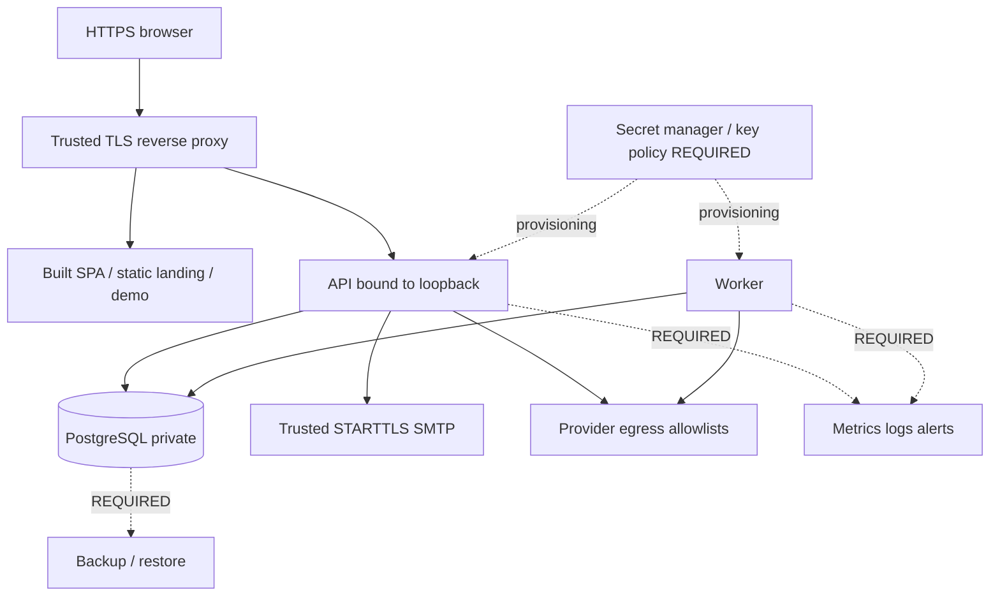

# Infrastructure / DevOps

## Что есть в source

- compose.yaml: только PostgreSQL service с persistent volume, loopback port mapping и pg_isready healthcheck. Это не full-stack production Compose.
- Dockerfile: Go build stage → distroless/static-debian12 nonroot runtime, отдельные API/worker/CLI executables; default command api. SPA в runtime image не отдаётся.
- Makefile: up/down, migrate, lint, test, test-integration, build. Goose SQL migrations; golangci/vet/gofmt.
- .github/workflows/ci.yml (точное имя см. evidence inventory): Ubuntu runner + PostgreSQL service; Go lint/test/race/build/migrate/integration/race integration.
- web/package.json: TS/ESLint/Vitest/build/Playwright smoke scripts; CI workflow не содержит npm jobs.
- SMTP abstraction для email verification/reset; sender требует STARTTLS и проверяет TLS certificate.
- Structured slog; health/live и health/ready; Doctor и operation progress.
- Нет подтверждённой infra для Redis, broker, object storage, distributed cache, metrics backend, log collector, deployment manifests или IaC.

## Развёртывание: требуемая схема, не готовый production manifest

Пунктирные блоки — необходимые operational capabilities, не утверждение реализованных integrations. API loopback assumption требует colocated trusted proxy или специального networking design; нельзя просто bind 0.0.0.0 и считать существующие проверки подходящими.

## Environment

Полный список имён, извлечённый из кода/примера, добавлен ниже. Значения не включены. Группы: DB/address/timeouts; worker poll/lease/retry; merchant origin/proxy/SMTP; provider keys/read limits; credential encryption; test stock/catalog gates; diagnostics.

Production merchant startup fail-closed без encryption и SMTP. Environment fallback для provider imports сохраняется лишь со scope/registration checks. Наличие переменной test publication не означает permit общего production write.

## CI/CD gap

CI ориентирован на Go/DB; frontend typecheck/test/build/browser matrix не интегрированы в показанный workflow. Deployment/promotion/rollback job не найден. Нет подтверждённого image signing/SBOM/secrets scan, pinned image digests, vulnerability gate, environment approvals или automated database backup. Отсутствие здесь — отсутствие в просмотренном repo, не доказательство отсутствия во всей компании.

Dockerfile собирает не все текущие cmd entrypoints по сравнению с Makefile: inventory сравнения нужен в release checklist. Build context hygiene проблематична: .dockerignore не исключает .local, node_modules, dist. Даже если финальный runtime copy содержит только executables, builder уже видел context.

## Миграции и rollback

make migrate применяет Goose Up по DATABASE_URL. В текущем аудите не запускался. Down может преднамеренно запрещать потерю audit/identity/evidence; миграция 42 security correction сохраняется на rollback. Нужна стратегия expand/contract и версия совместимости worker/API/schema; downgrade binary, schema down и восстановление backup — разные операции.

Нельзя запускать integration tests на рабочей базе: fixtures создают schemas/tables/данные и могут выполнять destructive cleanup. TEST_DATABASE_URL должен быть dedicated local disposable database. Некоторые тесты требуют loopback host и суффикс _test.

## Backups/monitoring

Подтверждены pg volume и durable records; volume не является backup. Не найдены расписание snapshots/PITR, RPO/RTO, restore runbook, encryption-key restore или alert routing. Для первого клиента нужны измеримые критерии восстановления и проверка decrypt после restore.

Health readiness проверяет DB ping, не SMTP, vendor readiness, очередь, schema version или freshness. Нужны queue age/lag, unresolved outcomes, retry counts, auth/SMTP failures, worker progress, account quota saturation, storage/WAL и restore status.

## Предыдущий локальный стенд

Из прошлого этапа беседы известно о поднятых DB/Mailpit/API/Vite/worker и successful mock task. Это не проверка текущей доступности, не production design и не действие этого аудита. .local запускающие скрипты и их secret-bearing content не читались.

## Обязательное перед production

TLS/proxy/network review; minimal secrets/rotation; least-privilege DB roles; backups/restore; full-stack CI; durable unknown/reconciliation runbooks; worker fairness/quotas; migration compatibility; capability/tenant security E2E; operator emergency stop; production billing/legal decisions. Не включать arbitrary customer writes снятием test gate.

## Source evidence index

Static inspection only. Line numbers refer to this working tree, not a release tag. External sibling paths are intentionally absolute; source is not included in the ZIP.

| Source | Symbols / evidence lines |
|---|---|
| [compose.yaml:1](../../compose.yaml#L1) | configuration / declarations; see file |
| [Dockerfile:1](../../Dockerfile#L1) | configuration / declarations; see file |
| [.dockerignore:1](../../.dockerignore#L1) | configuration / declarations; see file |
| [Makefile:1](../../Makefile#L1) | configuration / declarations; see file |
| [internal/config/config.go:1](../../internal/config/config.go#L1) | 18: Load; 46: value |
| [cmd/api/main.go:1](../../cmd/api/main.go#L1) | 21: main; 27: run; 66: configuredHandler; 90: apiForMode |
| [cmd/worker/main.go:1](../../cmd/worker/main.go#L1) | 28: catalogClient; 85: moyskladCatalogClient; 142: main; 148: run |
| [internal/identity/smtp.go:1](../../internal/identity/smtp.go#L1) | 33: NewSMTP; 42: Send; 74: closeConnection; 80: secure; 95: deliver; 116: mailContent |
| [internal/transport/http.go:1](../../internal/transport/http.go#L1) | 10: Handler |
| [web/package.json:1](../../web/package.json#L1) | configuration / declarations; see file |
| [.github/workflows/ci.yml:1](../../.github/workflows/ci.yml#L1) | configuration / declarations; see file |

## Environment-name inventory

Values intentionally omitted. Presence in source does not imply deployment configuration.

| Variable | Source evidence |
|---|---|
| `DATABASE_URL` | `cmd/doctor/main.go:49`, `internal/config/config.go:19`, `.env.example:1` |
| `HTTP_ADDR` | `internal/config/config.go:19`, `.env.example:2` |
| `MOYSKLAD_ACCOUNT_ID` | `cmd/doctor/main.go:79`, `cmd/moysklad-fixtures/main.go:64`, `cmd/moysklad-import/main.go:37` |
| `MOYSKLAD_HTTP_TIMEOUT` | `cmd/moysklad-import/main.go:41`, `cmd/moysklad-orders/main.go:79`, `cmd/worker/main.go:97` |
| `MOYSKLAD_MAX_ATTEMPTS` | `cmd/moysklad-import/main.go:58`, `cmd/moysklad-orders/main.go:96`, `cmd/worker/main.go:129` |
| `MOYSKLAD_MAX_RETRY_AFTER` | `cmd/moysklad-import/main.go:53`, `cmd/moysklad-orders/main.go:91`, `cmd/worker/main.go:121` |
| `MOYSKLAD_REQUEST_INTERVAL` | `cmd/moysklad-import/main.go:45`, `cmd/moysklad-orders/main.go:83`, `cmd/worker/main.go:104` |
| `MOYSKLAD_RETRY_BACKOFF` | `cmd/moysklad-import/main.go:49`, `cmd/moysklad-orders/main.go:87`, `cmd/worker/main.go:111` |
| `MOYSKLAD_TOKEN` | `cmd/doctor/main.go:79`, `cmd/moysklad-fixtures/main.go:108`, `cmd/moysklad-import/main.go:36` |
| `OZON_API_KEY` | `cmd/doctor/main.go:86`, `cmd/ozon-import/main.go:61`, `cmd/ozon-postings/main.go:122` |
| `OZON_CLIENT_ID` | `cmd/doctor/main.go:86`, `cmd/ozon-import/main.go:61`, `cmd/ozon-postings/main.go:83` |
| `OZON_HTTP_TIMEOUT` | `cmd/ozon-import/main.go:65`, `cmd/ozon-postings/main.go:99`, `cmd/worker/main.go:40` |
| `OZON_MAX_ATTEMPTS` | `cmd/ozon-import/main.go:82`, `cmd/ozon-postings/main.go:116`, `cmd/worker/main.go:72` |
| `OZON_MAX_RETRY_AFTER` | `cmd/ozon-import/main.go:77`, `cmd/ozon-postings/main.go:111`, `cmd/worker/main.go:64` |
| `OZON_REQUEST_INTERVAL` | `cmd/ozon-import/main.go:69`, `cmd/ozon-postings/main.go:103`, `cmd/worker/main.go:47` |
| `OZON_RETRY_BACKOFF` | `cmd/ozon-import/main.go:73`, `cmd/ozon-postings/main.go:107`, `cmd/worker/main.go:54` |
| `QUERY_TIMEOUT` | `.env.example:13` |
| `SHUTDOWN_TIMEOUT` | `.env.example:14` |
| `STYK_ALLOW_REMOTE_BIND` | `cmd/api/main.go:72` |
| `STYK_AUTH_MODE` | `cmd/api/main.go:67`, `.env.example:4` |
| `STYK_CATALOG_REQUEST_AUDIT` | `internal/catalogprovider/audit.go:14`, `.env.example:40` |
| `STYK_CONSOLE_ORIGIN` | `cmd/api/main.go:91`, `.env.example:10` |
| `STYK_CREDENTIAL_ENCRYPTION_KEY` | `internal/credentials/vault.go:81`, `.env.example:5` |
| `STYK_FIXTURE_CONFIRM_ACCOUNT_ID` | `cmd/moysklad-fixtures/main.go:101` |
| `STYK_FIXTURE_ISOLATED_TEST_ACCOUNT` | `cmd/moysklad-fixtures/main.go:101` |
| `STYK_LOCAL_CLAIM_ENABLE` | `cmd/claim-workspace/main.go:32` |
| `STYK_REVIEW_LIFETIME` | `internal/console/http.go:33`, `.env.example:12` |
| `STYK_SMTP_ADDRESS` | `cmd/api/main.go:99`, `.env.example:6` |
| `STYK_SMTP_FROM` | `cmd/api/main.go:99`, `.env.example:7` |
| `STYK_SMTP_PASSWORD` | `cmd/api/main.go:99`, `.env.example:9` |
| `STYK_SMTP_USERNAME` | `cmd/api/main.go:99`, `.env.example:8` |
| `STYK_STOCK_PUBLICATION_ENABLED` | `internal/config/stock_publication.go:14` |
| `STYK_STOCK_PUBLICATION_TEST_ENDPOINT` | `internal/config/stock_publication.go:17` |
| `STYK_TEST_ACCOUNT_CATALOG` | `cmd/worker/catalog.go:42`, `cmd/worker/catalog.go:47`, `internal/console/catalog_sync.go:54` |
| `STYK_TEST_ACCOUNT_PUBLICATION` | `internal/testpublication/policy.go:35` |
| `STYK_TRUSTED_PROXY_CIDRS` | `internal/console/merchant_auth.go:45` |
| `WORKER_LEASE_DURATION` | `.env.example:16` |
| `WORKER_MAX_ATTEMPTS` | `internal/config/config.go:30`, `.env.example:18` |
| `WORKER_POLL_INTERVAL` | `.env.example:15` |
| `WORKER_RETRY_DELAY` | `.env.example:17` |

## SMTP delivery semantics

`merchantAuth.deliverVerification` creates a verification intent and invokes the sender synchronously; failure is logged generically. A 202 registration response is not a proof that the recipient received email. No separate durable email outbox/delivery retry worker was identified in this path. The readiness endpoint does not test SMTP delivery. Monitor and test this before self-service onboarding.

`SITE_URL` is an additional landing-build environment variable (E:/work/styk-landing/scripts/prerender.mjs); only its name is recorded. It controls canonical/OG URL and sitemap generation.
