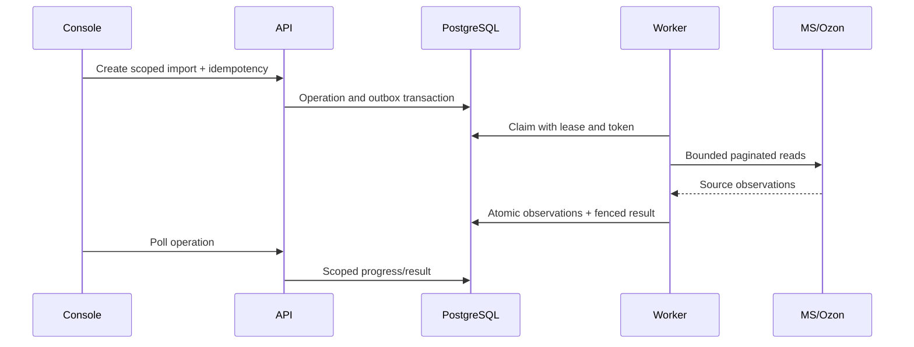

# Потоки данных и инварианты

## 1. Identity и ownership

Посетитель вводит email → public handler создаёт pending user/workspace/merchant binding в transaction → verification token hash сохраняется → SMTP доставляет fragment link → пользователь задаёт пароль и подтверждает адрес → Authenticate → CreateSession сохраняет token digest/CSRF/audit → HttpOnly cookie.

На каждом protected request: safe Host/Origin/loopback peer → session lookup/expiry/auth_version → CSRF на mutation → MerchantTenant → tenant query/body normalization/object ownership → action audit → business handler → transaction actor guard. Это account isolation, не role management UI.

Reset меняет credential/auth lineage по identity/reset.go; клиентские caches должны очищаться при session loss. В браузере CSRF в памяти, auth cookie не в sessionStorage.

## 2. Credentials

UI → credentials save/probe request → strict bounds/scope checks → provider identity probe вне DB transaction → match exact account → encrypted payload с revision/AAD → transaction ownership check/request idempotency/credential save → metadata readback. Provider probe успех не доказывает все будущие permissions.

Disconnect меняет enabled/revision, сохраняет history. Pending intents с frozen credential revision должны остановиться/reconcile, а не молча взять новый ключ. Master key rotation — отдельная отсутствующая эксплуатационная процедура.

## 3. Read imports

Transient reads можно повторять в рамках attempts/backoff/budget. Expired worker не завершает чужой claim. Failed traversal не публикуется как complete. Latest complete identical catalog may dedup; append history policies для postings другие. Import finished timestamp — локальное завершение обхода, не provider snapshot time.

## 4. Product lifecycle

Provider IDs → persisted source entities / Ozon product observations → candidate generation (seller offer vs MS article/code) → human review → durable mapping review freezes import revisions → confirm rechecks evidence under locks → mapping current + immutable history/audit/idempotency.

Name similarity не авторизует mapping. Общий seller article не доказывает unit conversion, размер упаковки или physical identity. Разные Ozon targets, ссылающиеся на один MS item, требуют отдельного stock allocation policy.

Catalog enrichment не заменяет mappings: created product association ещё не означает подтверждённую физическую stock связь.

## 5. Warehouse lifecycle

Source stores/market warehouses observations → FBS eligibility/identity comparison → explicit review/confirmation → one-to-one constraints/history. Названия складов не authority. Provider warehouse status/rFBS трактуются по actual DTO/validator, отсутствие поля не подменяется подходящим default.

## 6. Stock lifecycle

MS aggregate/per-warehouse facts + Ozon present/reserved/free_stock + posting/customer-order evidence → scoped pool/target/policy → proof-driven commitment calculation → frozen decision/evidence.

Расчёт использует physical stock, reserves, unreflected obligations, unseen reduction bound, safety stock и age/coverage/unit/mapping proofs. Нельзя заменить его одной строкой «stock − reserve» и считать безопасной production формулой. Negative/fractional/unknown/missing quantities и неполная coverage блокируют или делают результат unknown согласно domain rules.

Preview/settings/review → durable publication targets → claim/dispatch journal/final guards → exact frozen quantity POST only allowlisted target → inspect per-target updated/errors → record receipt/outcome → bounded readback → reconcile. HTTP timeout или updated=false не доказывают, что можно немедленно resend.

General real-host production publication hold остаётся. Simulator и fixed test account experiments — отдельные paths, не штатная возможность любого клиента. Не обещать buyer isolation для реального provider test account.

## 7. Catalog lifecycle и loop prevention

Config определяет единственный authority на поле: MOYSKLAD_AUTHORITATIVE/OZON_AUTHORITATIVE/MANUAL/IGNORE. Source/target observations + baseline fingerprints → BuildPlan → changes/conflicts/skips. Concurrent independent edits относительно baseline дают conflict, а не silent winner.

Preview хранит config/credential/mapping revisions, выбранные значения и validation. Approval выбирает целый product, не меняет field payload. Dispatch повторно читает source/target, проверяет fingerprint/guard и журналирует intent. Provider response/task polling/readback отделены. Только verified observation может продвинуть baseline.

Это уменьшает ping-pong, но не устраняет все гонки с внешним редактором между последним read и write. Отсутствие vendor atomic write fence — существенное ограничение. Unknown target blocks subsequent writes. Reconciliation читает и фиксирует факты, не превращает uncertain result в success ради UI.

Ozon update ограничен name/description. Product create и MS richer payload идут отдельными validators. Price/images в generic model не дают полномочия массового обновления.

## 8. Order lifecycle

Ozon FBS list → details → immutable batch/identity/lines. MS customerorder updated-window → details/positions → scoped identities/batch. Correlation сопоставляет доказательства; explicit IDs/sync references сильнее heuristic coincidences. Read order status сохраняется как observation, не state machine fulfillment.

On-demand refresh может дробить coverage windows и сохранять progress/revisions. Ограничение по времени/строкам и permissions означает incomplete/unknown coverage; отсутствие order в обходе не означает cancellation.

Внешнее создание заказов, резервов, shipment dispatch, cancellation, labels и returns не реализовано общим workflow. Следовательно, duplicate external order prevention нельзя считать завершённой write-возможностью: writer ещё нет.

## 9. Price lifecycle

Price может быть прочитан в catalog facts и включён в ограниченные payloads. Нет отдельного scheduler mass repricing, markup rules, fee/margin model, price history UI или checkout/billing prices. Demo Pricing изменяет только локальное состояние. Валюта/единица/rounding/provider-price-type должны оставаться явными при будущем развитии.

## 10. Риски и защита

| Сбой | Существующий механизм | Остаточная неопределённость |
|---|---|---|
| Повтор HTTP submit | idempotency records/request hash | клиент должен повторять тот же intent |
| Restart read worker | lease/token/fenced commit | повтор чтения, quota/cost |
| Restart during write | DISPATCHING→UNKNOWN, target fence | provider remote outcome нужно читать |
| Partial bulk result | per-target receipt/results | response mapping/current vendor contract |
| Stale imports | observation age/revisions/proofs | нет абсолютного snapshot |
| Cross-tenant input | binding/middleware/SQL/FK/actor | новые routes/trusted DB operations |
| External concurrent edit | freshDecision/expected revision | atomic provider compare-and-set не доказан |
| Per-account overload | instance limiter/budgets | multi-process quota coordination |
| Long backlog | bounded work/progress | priority starvation/latency SLA |

## Source evidence index

Static inspection only. Line numbers refer to this working tree, not a release tag. External sibling paths are intentionally absolute; source is not included in the ZIP.

| Source | Symbols / evidence lines |
|---|---|
| [internal/identity/users.go:1](../../internal/identity/users.go#L1) | 14: Register; 40: RegisterPending; 48: insertRegistration; 75: insertWorkspace; 85: event; 95: RecordAction; 109: Authenticate; 134: AllowAuthAttempt |
| [internal/identity/verification.go:1](../../internal/identity/verification.go#L1) | 13: CreateVerification; 43: VerifyEmail; 75: lockVerificationUser; 93: finishVerification |
| [internal/identity/sessions.go:1](../../internal/identity/sessions.go#L1) | 13: CreateSession; 37: insertSession; 60: Session; 80: RevokeSession |
| [internal/credentials/vault.go:1](../../internal/credentials/vault.go#L1) | 31: Valid; 34: validID; 50: Scope; 63: New; 80: FromEnvironment; 95: aad; 105: Encrypt; 122: Decrypt; 143: Digest; 161: Resolve; 168: ResolveWithRevision; 195: ScopeKey |
| [internal/postgres/import_operations.go:1](../../internal/postgres/import_operations.go#L1) | 33: validImportScope; 38: SubmitOzonImport; 42: SubmitCatalogImport; 49: SubmitScheduledCatalogImport; 53: submitCatalogImport; 127: scanImport; 167: GetImportOperation; 170: GetCatalogOperation; 182: ListImportOperations; 185: ListCatalogOperations; 220: CancelQueuedImport; 223: CancelCatalogImport |
| [internal/postgres/import.go:1](../../internal/postgres/import.go#L1) | 13: SaveInventoryImport; 34: saveInventoryImportTx |
| [internal/postgres/ozon_import.go:1](../../internal/postgres/ozon_import.go#L1) | 13: SaveOzonImport; 40: saveOzonImportTx |
| [internal/commitment/calculator.go:1](../../internal/commitment/calculator.go#L1) | 44: Evaluate; 236: proofAccepted; 243: SourceFreshnessTime; 250: wholeNonnegative |
| [internal/catalog/plan.go:1](../../internal/catalog/plan.go#L1) | 82: BuildPlan; 101: newPlan; 106: validatePlanRequest; 124: valid; 128: policyFields; 137: addField; 172: fieldPairFor; 188: valueAt; 196: manualValueAt; 204: baselineAt; 214: skipReason; 233: sourceSkipReason |
| [internal/catalogsync/runner.go:1](../../internal/catalogsync/runner.go#L1) | 21: RunNext; 54: dispatch; 87: write; 101: complete; 112: stop; 121: now; 128: validate; 154: corresponds; 169: containsCommand |
| [internal/stocksync/runner.go:1](../../internal/stocksync/runner.go#L1) | 28: MaintainPresence; 47: RunNext; 222: Reconcile |
| [internal/infrastructure/ozon/postings.go:1](../../internal/infrastructure/ozon/postings.go#L1) | 41: ReadPostings |
| [internal/infrastructure/moysklad/customer_orders.go:1](../../internal/infrastructure/moysklad/customer_orders.go#L1) | 34: refID; 57: ReadCustomerOrders |
